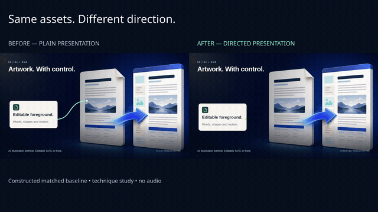
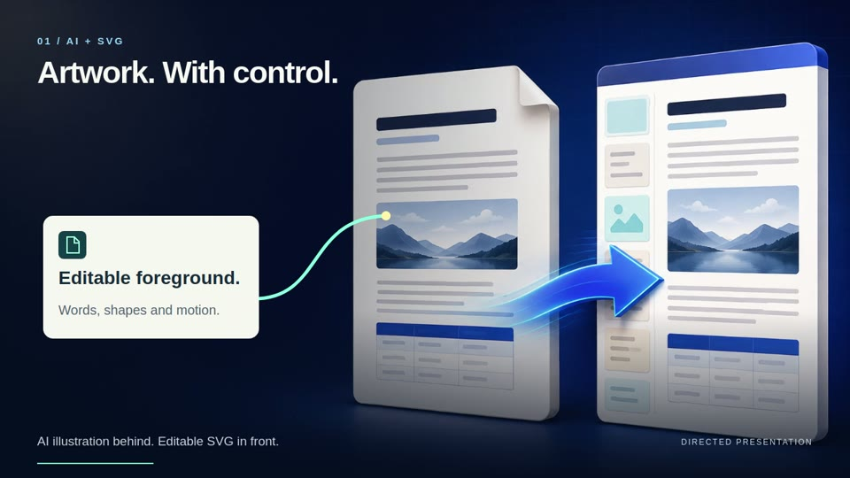
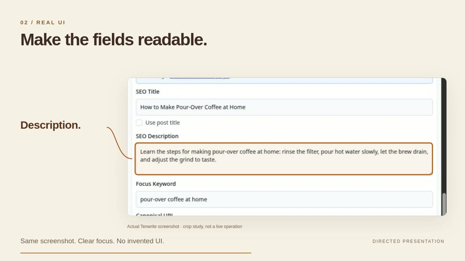
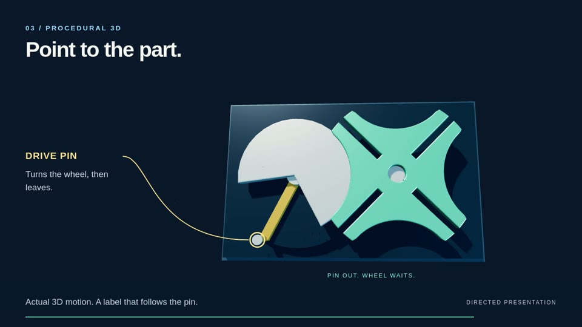

# Video Director

**Make it move. Keep it editable.**

Make product demos, animated diagrams and 3D explainers with your AI agent. Combine **real screenshots, crisp SVG graphics, working 3D and AI artwork where it helps**—with readable close-ups, labels that follow the action, and smooth motion.

Change the words, timing or camera move in code. Reuse the good assets. Render the next version without generating the whole shot again.

An installable agent skill. No new video app to learn.

[Get started](#get-started) · [See the demo](#see-the-difference) · [Explore the recipes](#pick-your-kind-of-video)

## Get started

### Install the skill

With Node.js **22.20+** and npm, run:

```bash
npx skills add aakashH242/video-director --skill video-director --global
```

Choose your coding agent when prompted. `--global` makes the skill available across projects; leave it off to install in the current project. You don't need to publish or install a separate video app.

<details>
<summary><strong>Codex-only or manual installation</strong></summary>

Install globally for Codex:

```bash
npx skills add aakashH242/video-director --skill video-director --global --agent codex
```

Or clone into a global skill location supported by your agent:

```bash
git clone https://github.com/aakashH242/video-director.git ~/.agents/skills/video-director
```

Already have a modified checkout? Preserve it and update deliberately—don't install or clone over your work. The [Skills CLI reference](https://github.com/vercel-labs/skills/blob/main/docs/commands.md) covers agents, installation scope and updates.

</details>

Then ask:

> Use $video-director to make a 30-second product demo with readable real UI, smooth motion and clear annotations. Give me an MP4 to review.

Or:

> Use $video-director to explain this mechanism in 45 seconds. Show the whole thing, then close-ups. Highlight each part as the narration names it.

### Render your first video

Try the bundled eight-second SVG explainer. **No API key, paid generation or private assets.** Installing the skill supplies its instructions, examples and helpers; rendering also needs FFmpeg/FFprobe, project packages and Chromium.

<details>
<summary><strong>First-video setup and commands</strong></summary>

Replace `/path/to/video-director` with your installed skill's location:

```bash
node /path/to/video-director/scripts/create-example.mjs my-first-video
cd my-first-video
npm ci
npm run browser:install
npm run doctor
npm run render
npm run verify
```

Your MP4 is `my-first-video/output/first-video.mp4`: 720p, 60 fps, silent. The new folder must not already exist. The explicit install steps download project packages and Chromium, not OS dependencies.

</details>

[First-video walkthrough and troubleshooting →](references/first-video.md)

Read [SKILL.md](SKILL.md) for the entry point and [production.md](references/production.md) for more capture options.

## See the difference

The same assets, presented two ways: a plain overview on the left; directed motion, readable crops and tracked labels on the right.

<a href="docs/showcase/before-after.mp4?raw=true" title="Download the full 18-second before/after MP4">
  
</a>

**[Download the full-quality MP4 →](docs/showcase/before-after.mp4?raw=true)** · 18 seconds · 1080p · 60 fps · silent

## A closer look

| AI artwork + SVG | Readable product UI | 3D + tracked annotations |
| :---: | :---: | :---: |
| <a href="docs/showcase/hybrid.jpg"></a> | <a href="docs/showcase/real-ui.jpg"></a> | <a href="docs/showcase/3d-annotations.jpg"></a> |
| Keep the art. Control the words and motion. | Show the field people need to read. | Point to the part you're explaining. |

## One painting. Editable action.

A generated hillside becomes the setting. The solar panel, lamp, energy path and labels stay in SVG. Watch the final wipe reveal the layers.

<a href="assets/hybrid-demo/README.md" title="Open the editable AI background + SVG example">
  
</a>

**[Open the editable example →](assets/hybrid-demo/README.md)** · 12 seconds · silent · one generated still, code-controlled motion

Change a label, colour or pause. Keep the same painting. The example includes the original background, exact prompt and runnable source.

## Iterate in code. Save generation for what needs it.

A new label shouldn't need a new video generation. Neither should a slower zoom, a longer pause or a different camera angle.

For **UI, diagrams, SVG graphics and procedural 3D**, Video Director gives you a practical alternative to regenerating images or clips for each revision:

- **Edit the exact thing you want to change.** Update a word, colour, highlight, camera path or timing without replacing the rest of the scene.
- **Reuse artwork across versions.** Generate a background when you need one, then keep titles, foreground objects and animation separate.
- **Capture real screens.** Show the actual interface instead of spending image-generation credits trying to recreate it.
- **Reuse your renders as stills.** Pull frames for diagrams, thumbnails or feature images from the same scene.
- **Check a quick timing pass first.** Adjust the choreography before spending time on the final high-frame-rate render.

That can mean **lower generation spend and faster iteration** for these kinds of scenes. It isn't a universal replacement for image or video models but meant to complement them. Use them for artwork or footage that needs them; use code for the parts you want precise control over. Total cost and speed still depend on agent usage, assets, scene complexity and your hardware.

## What it helps you do

- **Show the useful bit first.** Plan an opening around the result, then explain how it works.
- **Make real screens readable.** Use deliberate crops, visible actions and holds long enough to follow. Keep screenshots honest; don't fake a live operation.
- **Keep text and diagrams editable.** Use generated artwork for atmosphere, then add crisp SVG/HTML foregrounds, arrows and labels in code.
- **Explain moving parts.** Build tested 3D motion, move in for the contact, and attach labels to the part—not a random spot on screen.
- **Render smooth motion.** Capture exact frames on a controlled timeline, even when a scene renders slower than real time.
- **Give narration room to breathe.** Assemble approved speech clips with natural pauses and measured timings.
- **Check the actual export.** Spot decoding errors and wrong frame counts, then inspect the transitions before handing over the MP4.

## Pick your kind of video

**Launching a product?** Start with [real UI](references/real-ui.md): show where to go, what to click and what changes.

**Explaining how something works?** Use [3D explainers](references/3d-explainers.md): establish the whole, reveal the parts and follow the motion.

**Making an illustrated story or advert?** Use [hybrid scenes](references/hybrid-scenes.md): approved AI artwork behind an editable foreground.

**Comparing two versions?** Use the [before/after starter](references/before-after.md): matched assets, timing and export settings, with clear labels.

Mix these approaches when the story needs it. A product demo doesn't have to look like a mechanical explainer, and the next video doesn't have to reuse the last video's colours.

## What's in the box?

| Included | What you get |
| --- | --- |
| [Skill instructions](SKILL.md) | Shot planning, visual choices and the right recipe for the video. |
| [Recipes](references/) | Hybrid artwork, real UI, 3D, audio, comparisons and production checks. |
| [Working scripts](scripts/) | Frame-exact capture, local serving, audio pauses, side-by-side comparisons and export verification. |
| [Runnable first video](assets/first-video/) | A complete, editable SVG explainer with locked dependencies, setup checks and export commands. |
| [AI background + SVG demo](assets/hybrid-demo/README.md) | A generated painting with editable equipment, tracked labels and a layer reveal. |
| [Editable starter](assets/comparison-study/) | The three-scene study, ready for your own approved art, screenshot and Three.js dependency. |
| [Showcase](docs/showcase/) | The demo and small screenshots shown above. |

### Runtime

Use current **Node 22, 24 or 26**, **FFmpeg/FFprobe** with CPU H.264, and **Playwright with Chromium**. The runnable example pins Playwright **1.64.1**. The optional 3D starter uses **Three.js r169**. See the [tested setup and limits](docs/tested-setup.md) and [capture guide](references/production.md).

<details>
<summary><strong>Run the checks</strong></summary>

From your video project, set `VIDEO_DIRECTOR_RUNTIME` to an existing runtime's absolute `package.json` path if Playwright isn't installed there. Replace `<skill>` with this checkout's path:

```bash
node <skill>/scripts/self-test.mjs
node <skill>/scripts/boundary-test.mjs
node <skill>/scripts/setup-test.mjs
node <skill>/scripts/hybrid-test.mjs
node --test <skill>/assets/first-video/scene.test.mjs
node --test <skill>/assets/comparison-study/mechanics.test.mjs
```

The [production guide](references/production.md) covers capture and encoded-output verification. Technical checks support visual review; they don't replace watching the result or listening to the voice.

</details>

## License

The original skill instructions, code and documentation are [MIT licensed](LICENSE). Existing third-party notices remain in place. Bundled artwork, screenshots and rendered media are not included in that code/documentation licence; see [licence scope and provenance](references/lineage.md#licence-scope).

---

[Production guide](references/production.md) · [Audio and narration](references/audio.md) · [Optional MoneyPrinterTurbo integration](references/moneyprinterturbo.md) · [Credits and licences](references/lineage.md)
